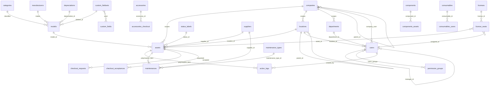

# Database schema — the tables our customisations touch

Snipe-IT v8.8.0, MariaDB/MySQL, 495 migrations in `database/migrations`. There is
no `database/schema` dump in this repo, so the columns below were read from the
Eloquent models (fillable arrays, casts, relations) and the relevant migrations —
**not** from a live database. Treat the relationships as accurate and the column
lists as near-complete; `DESCRIBE <table>` is the authority once a local
instance is up.

Scope: the core asset tables plus everything the enterprise work in
`API_DESIGN.md` reads or writes. Licences, accessories, consumables and
components are included because they share the checkout machinery; LDAP, SCIM,
SAML, OIDC, imports, backups and label templates are out of scope.

## Shape of the thing, in one paragraph

An **asset** is an instance of a **model**, which belongs to a **category** and a
**manufacturer**. Its availability is a **status label**. It sits at a
**location** and, when checked out, is assigned polymorphically to a user, a
location or another asset. Every state change writes an **action log** row — that
table, not a diff on `assets`, is the audit trail. **Companies** are the
multi-tenant boundary (FMCS), **departments** group users, and permissions live
as a JSON blob on **permission groups**.

## ER diagram (core)

Mermaid cannot express a polymorphic foreign key, so `action_logs` and
`maintenances` are drawn against `assets`; in reality their `item_type` may be
any checkoutable model. The same applies to `assets.assigned_type`, which may
point at a user, a location or another asset.

## assets

`app/Models/Asset.php`, table `assets`.

| Column | Notes |
| --- | --- |
| `id` | primary key |
| `asset_tag` | the human and scanned identifier, unique per company, **not** the primary key. `GET /api/v1/hardware/bytag/{tag}` resolves it |
| `serial` | manufacturer serial |
| `name` | optional friendly name |
| `model_id` | to `models.id` |
| `status_id` | to `status_labels.id`, decides deployable / pending / archived |
| `assigned_to`, `assigned_type` | polymorphic checkout target, constrained in the model to User, Location or Asset |
| `location_id` | where it is now, derived on checkout |
| `rtd_location_id` | return-to-default home location, used on checkin |
| `company_id` | to `companies.id`, the FMCS scope |
| `supplier_id` | to `suppliers.id` |
| `purchase_date`, `purchase_cost`, `order_number` | procurement |
| `warranty_months` | drives warranty expiry, see `WORKFLOWS.md` |
| `asset_eol_date`, `eol_explicit` | end of life; the explicit flag stops recalculation from the model's eol months |
| `last_checkout`, `last_checkin`, `expected_checkin` | checkout clock; `expected_checkin` became a datetime in migration 2026_07_17 |
| `last_audit_date`, `next_audit_date` | the audit cycle our inventory sessions build on |
| `requestable` | may a standard user request it |
| `byod` | employee-owned |
| `image`, `notes` | |
| `deleted_at` | soft delete; queries need `withTrashed()` to see them |

**There is no `department_id`.** Confirmed absent from the model's fillable array
and from the migration list — this is the gap the asset-transfer feature in
`API_DESIGN.md` fills. Department is currently only reachable through
`assets.assigned_to` to `users.department_id`, which is empty for anything not
checked out to a person.

## models (AssetModel)

`category_id`, `manufacturer_id`, `depreciation_id`, `fieldset_id`, `name`,
`model_number`, `eol` (months), `min_amt` (low-stock threshold), `requestable`,
`require_serial`, `image`, `notes`.

`fieldset_id` is what makes custom fields appear on an asset, and `min_amt` is
what `GET /api/v1/low-stock` reads.

## categories

`name`, `category_type` (`asset`, `accessory`, `consumable`, `component`,
`license`), `eula_text`, `use_default_eula`, `require_acceptance`,
`checkin_email`, `alert_on_response`, `tag_color`, `notes`.

`require_acceptance` and the EULA fields drive `checkout_acceptances`, so a
category change changes a workflow, not just a label.

## status_labels

`name`, `deployable`, `pending`, `archived`, `notes`. The three booleans are a
state machine in disguise: deployable may be checked out, pending is in transit
or being prepared, archived is out of service and hidden from most lists.
Snipe-IT derives "Ready to Deploy", "Deployed", "Archived" and "Undeployable"
from these plus `assigned_to`.

## locations

`name`, `parent_id` (self-referencing tree, indexed in migration 2026_04_07),
`manager_id` to `users`, `company_id`, address block, `currency`, `ldap_ou`,
`image`, `tag_color`, `notes`.

## companies

`name`, `parent_id` (added 2026_06_22), `phone`, `fax`, `email`, webhook fields,
`tag_color`, `notes`, `deleted_at` (added 2026_03_26).

Companies are the Full Multiple Company Support boundary. `CompanyableScope` and
`CompanyableChildScope` add the `company_id` predicate globally when FMCS is on,
which is why **any new query must go through the model, never raw SQL** — see
`CUSTOMISATION_RULES.md`.

## departments

`name`, `location_id`, `company_id`, `manager_id`, `phone`, `fax`, `tag_color`,
`notes`, `created_by`. Users point at a department; assets do not.

## users

`first_name`, `last_name`, `display_name`, `username`, `email`, `password`,
`employee_num`, `jobtitle`, `phone`, `mobile`, `department_id`, `location_id`,
`manager_id` (self), `activated`, `locale`, address block, `start_date`,
`end_date`, `remote`, `vip`, `autoassign_licenses`, `ldap_import`,
`scim_externalid`, `avatar`, `notes`.

**Company membership is a pivot, not a column, as of v8.8.** Migration
`2026_05_19_000001_create_company_user_table` introduced `company_user`, and
`2026_07_10_000001` renamed `users.company_id` to `users.legacy_company_id` — a
mirror kept in sync for external consumers only. Anything we build reads
membership through the `companies()` relation. API, CSV and SCIM inputs named
`company_id` still work; they are routed into the pivot at the request layer.

## permission_groups and users_groups

`permission_groups`: `id`, `name`, `permissions` (a **JSON map of permission name
to the string "0" or "1"**), `notes`, `created_by`, `external_id`.
`users_groups`: `user_id`, `group_id`.

There is no permissions table and no roles table. See `ROLES_PERMISSIONS.md`.

## action_logs — the audit trail

`app/Models/Actionlog.php`. Fillable: `item_id` and `item_type` (polymorphic
subject), `target_id` and `target_type` (polymorphic counterparty, for example
the user an asset went to), `action_type` (`checkout`, `checkin`, `audit`,
`accepted`, `declined`, `update`, `create`, `delete`, `restore`, `requested`,
`uploaded` and others), `note`, `created_by`, `created_at`, `order_item_id`,
`stored_eula`. A `company_id` column exists and was backfilled from the item in
migration 2026_04_20.

Every checkout, checkin and audit writes a row here. Nothing we build may mutate
asset state without one.

## maintenances

Generalised in this line of Snipe-IT: the model is `Maintenance`, the table is
`maintenances`, and the subject is **polymorphic** (`item_id` and `item_type`).
`asset_id` and `completion_date` remain fillable only as legacy aliases routed
through mutators. Other columns: `maintenance_type_id` to `maintenance_types`
(added 2026_05_18), `asset_maintenance_type` (legacy string), `supplier_id`,
`is_warranty`, `start_date`, `expected_completion_date`,
`asset_maintenance_time`, `cost`, `notes`, `url`, `checked_out_to_id` and
`checked_out_to_type`, `responsible_party_id`, `completed_at`, `completed_by`.
Dates became datetimes in migration 2026_07_17.

New code passes `item_id` and `item_type`, never `asset_id`.

## Checkout side tables

| Table | Model | Key columns |
| --- | --- | --- |
| `license_seats` | LicenseSeat | `license_id`, `assigned_to` to users, `asset_id`, `notes` — one row per seat |
| `accessories_checkout` | AccessoryCheckout | `accessory_id`, polymorphic `assigned_to` and `assigned_type`, `note` (indexed 2026_04_07) |
| `components_assets` | ComponentAssignment | component to asset, with quantity |
| `consumables_users` | ConsumableAssignment | `consumable_id`, `assigned_to` — consumption is one-way, there is no checkin |
| `checkout_requests` | CheckoutRequest | `user_id`, polymorphic requestable, `quantity`, `fulfilled_quantity`, `start_date`, `end_date`, `state`, `notes` |
| `checkout_acceptances` | CheckoutAcceptance | polymorphic checkoutable, `assigned_to`, accepted and declined timestamps, signature filename, `stored_eula` |

## Custom fields

`custom_fields` (`name`, `element`, `format`, `field_values`, `field_encrypted`,
`is_unique`, `help_text`, `display_checkout`, `display_checkin`,
`display_audit`, `show_in_listview`, `show_in_email` and more),
`custom_fieldsets`, and the pivot `custom_field_custom_fieldset` carrying
`required` and `order`.

Field values are stored as **columns on `assets`**, named from the field's db
column, not as rows in a values table. Two consequences: adding a custom field
is a DDL change at runtime, and `assets` is wider in production than in a fresh
install. Any `SELECT *` on assets is therefore unpredictable — select columns
explicitly.

Fields with `field_encrypted` set are encrypted with `APP_KEY` and gated by the
`assets.view.encrypted_custom_fields` permission.

## Conventions that apply to every table

- `created_by` rather than `user_id` for provenance on most tables.
- Soft deletes (`deleted_at`) on assets, users, licences, accessories,
  consumables, components, locations, companies and models.
- `created_at` and `updated_at` throughout.
- Foreign keys are frequently **not** enforced in the database: several early
  migrations commented the constraints out. Referential integrity is an
  application concern here. Our new tables should declare constraints, but our
  code must not assume existing columns have them.
