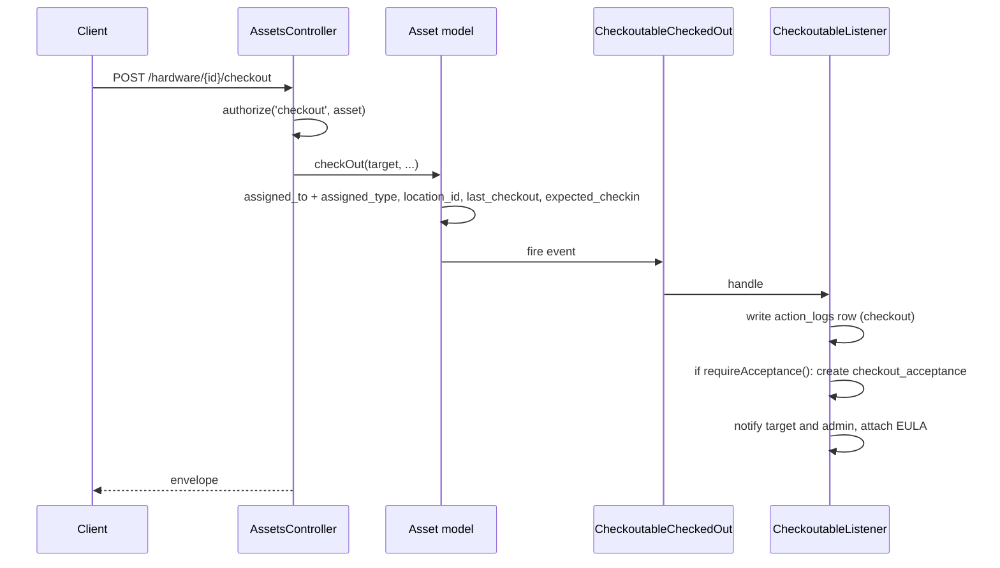

# Workflows — how asset state actually changes

Sources: `app/Models/Asset.php` (`checkOut`, `requireAcceptance`,
`checkInvalidNextAuditDate`), `app/Events/*`, `app/Listeners/CheckoutableListener.php`,
`app/Listeners/CheckoutablesCheckedOutInBulkListener.php`,
`app/Listeners/FulfillCheckoutRequestListener.php`,
`app/Http/Controllers/Api/AssetsController.php` (`audit`, `bulkAudit`,
`applyAssetAudit`), `app/Models/Statuslabel.php`.

Read this before designing anything that writes to an asset. Several of these
flows have side effects — mail, acceptance records, action logs — that a new
endpoint must trigger through the same events rather than reimplement.

## The state an asset is in

There is no single status column. An asset's state is the combination of its
**status label** booleans and whether `assigned_to` is set:

| Status label | `assigned_to` | Snipe-IT calls it |
| --- | --- | --- |
| deployable | null | Ready to Deploy |
| deployable | set | Deployed |
| pending | either | Pending |
| archived | either | Archived |
| none of the three | either | Undeployable |

Only a **deployable** status may be checked out. "Missing" and "damaged" are not
built in — organisations create non-deployable status labels with those names,
which is why the KPI endpoint in `API_DESIGN.md` has to be told which status ids
mean missing and damaged rather than inferring it.

## Checkout

`Asset::checkOut($target, $admin, $checkout_at, $expected_checkin, $note, $name, $location, $signInPlace)`.
API entry points: `POST /hardware/{id}/checkout` and
`POST /hardware/bytag/{tag}/checkout`.

What the flow decides, in order:

1. **Target type.** `checkout_to_type` is `user`, `location` or `asset`; the
   model validates `assigned_type` against exactly those three classes. Checking
   an asset out to another asset is how a laptop gets attached to a docking
   station, and it means `location_id` has to be resolved up the chain —
   `Asset::assetLoc()` recurses, which is why it carries an iteration guard.
2. **Location.** The asset's `location_id` becomes the target's location;
   `rtd_location_id` is left alone so checkin knows where home is.
3. **Acceptance.** If the category has `require_acceptance`, or the model or
   category supplies an EULA, a `checkout_acceptances` row is created and the
   asset is **deployed but unaccepted** until the person clicks through. This is
   a second state the UI shows and most integrations forget.
4. **Notification.** `CheckoutableListener` mails the target (and optionally the
   admin), with the EULA attached and stored on the acceptance record.
5. **Action log.** One `checkout` row, with the target as `target_id` and
   `target_type`.

Bulk checkout fires `CheckoutablesCheckedOutInBulk` and
`CheckoutablesCheckedOutInBulkListener`, which performs the same acceptance check
per asset. Any bulk endpoint we add must use the bulk event, not a loop over the
single path, or the mail volume becomes one message per asset.

## Checkin

`POST /hardware/{id}/checkin`, `POST /hardware/bytag/{tag}/checkin`,
`POST /hardware/checkinbytag`.

Clears `assigned_to` and `assigned_type`, sets `last_checkin`, returns
`location_id` to `rtd_location_id` unless a `location_id` is supplied, optionally
changes `status_id`, fires `CheckoutableCheckedIn`, writes a `checkin` action log,
and — if the category has `checkin_email` — mails the former holder.

`Asset::setAssignedTo(null)` nulls both polymorphic columns together. Writing one
without the other leaves a row that reads as "assigned to nothing of type User",
which several queries interpret as deployed. Never update one in isolation.

## Request and fulfilment

For assets with `requestable = 1` and users holding `assets.view.requestable`:

1. `POST /api/v1/account/request/{asset}` creates a `checkout_requests` row
   (`state`, `quantity`, `fulfilled_quantity`, optional start and end dates) and
   writes a `requested` action log.
2. A manager sees it under `GET /api/v1/requests`.
3. Checking the asset out to the requester fires `FulfillCheckoutRequestListener`,
   which closes the request.
4. `POST /api/v1/account/request/{asset}/cancel` withdraws it.

The same pattern exists for consumables, components and licences.

## Acceptance and declining

The person who received the item accepts or declines. Accepting fires
`CheckoutAccepted`, stores the signature image and the EULA text as served
(`stored_eula`), and writes an `accepted` action log. Declining fires
`CheckoutDeclined`, writes `declined`, and **checks the asset back in** — a
decline is not just a flag, it reverses the checkout. Any report counting
deployed assets has to decide whether unaccepted checkouts count; today's
dashboard counts them as deployed.

## Audit — the one we extend

`POST /hardware/{asset}/audit`, `POST /hardware/audit` (legacy, resolves the
asset from `audit_key` plus `audit_by_field`, default `asset_tag`), and
`POST /hardware/audit/bulk`.

`applyAssetAudit()` does exactly this:

1. Reads `Setting::audit_interval` (months) and sets
   `next_audit_date = now + interval`, unless the request supplies
   `next_audit_date` explicitly.
2. If `update_location == '1'`, writes `location_id` from the request. Without
   that flag the location is only mentioned in the audit note — a counter
   correcting a location **must** send the flag, which is the single most common
   integration mistake here.
3. Sets `last_audit_date` to now.
4. Optionally clears `name` when `clear_name == '1'`.
5. Accepts an uploaded image (`UploadFileRequest`) as audit evidence.
6. Returns a payload with the asset tag, the status label and type, the new
   `next_audit_date`, and the custom fields flagged `display_audit`.
7. Writes an `audit` action log row.

Authorisation runs **twice**: `authorize('audit', Asset::class)` and then
`authorize('audit', $resolvedAsset)`, deliberately, so FMCS company scoping is
enforced on the asset that was actually resolved rather than trusted from the
lookup. Copy this in every endpoint that resolves an asset from a request body.

Bulk audit takes `ids` plus one shared payload and returns a per-row envelope
with success and error counts. **This already covers most of "inventory
counting".** What it does not have is a session: an expected set, progress
against it, and a discrepancy report. That is the gap, not the audit write
itself — see `API_DESIGN.md`.

`Asset::checkInvalidNextAuditDate()` guards against a `next_audit_date` earlier
than `last_audit_date`.

## Maintenance

Create a `maintenances` row with `item_id` and `item_type`, a
`maintenance_type_id`, `start_date`, `expected_completion_date`, `supplier_id`,
`cost`, `is_warranty`, and optionally `responsible_party_id`.
`POST /api/v1/maintenances/{maintenance}/complete` sets `completed_at` and
`completed_by`. Notes are separate rows under `{maintenance}/notes`.

Maintenance does **not** change `status_id` or check the asset in. An asset away
for repair still reads as deployed to its holder unless someone also moves it to
a pending or undeployable status. Whether to automate that is a policy decision
to make before the maintenance-schedule work, not during it.

## Warranty expiry

`assets.warranty_months` plus `purchase_date` gives the expiry date; it is
computed, not stored. `GET /api/v1/calendar/events` surfaces expiries as calendar
events, and the UI shows a warranty report. There is no "expiring within N days"
query and no alerting, which is why `API_DESIGN.md` adds one.

## Depreciation and end of life

`depreciations` attach to models, and `assets.asset_eol_date` is derived from the
model's `eol` months unless `eol_explicit` is set. Setting `asset_eol_date`
directly sets `eol_explicit`, which then stops the model from recalculating it.
Our transfer and inventory flows must never touch either field.

## Rules every new write path must follow

1. **Fire the existing event.** Writing `assigned_to` without
   `CheckoutableCheckedOut` skips the action log, the acceptance record and the
   notification. The audit trail is the product, not a side effect.
2. **Never update one half of a polymorphic pair.**
3. **Authorise the resolved model**, not just the class, whenever the identifier
   came from a request body.
4. **Go through Eloquent** so `CompanyableScope` applies. Raw SQL silently
   crosses the tenant boundary.
5. **Bulk means the bulk event**, so notifications stay batched.
6. **Status transitions are data, not code.** Never hard-code a status id or
   name; take it as configuration.
